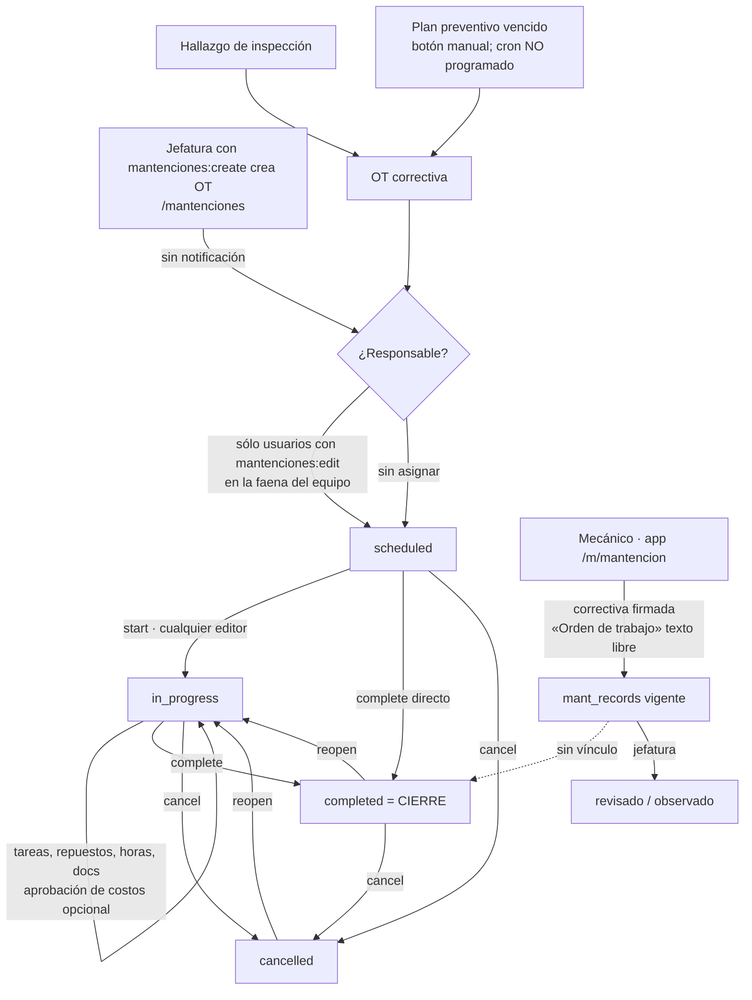
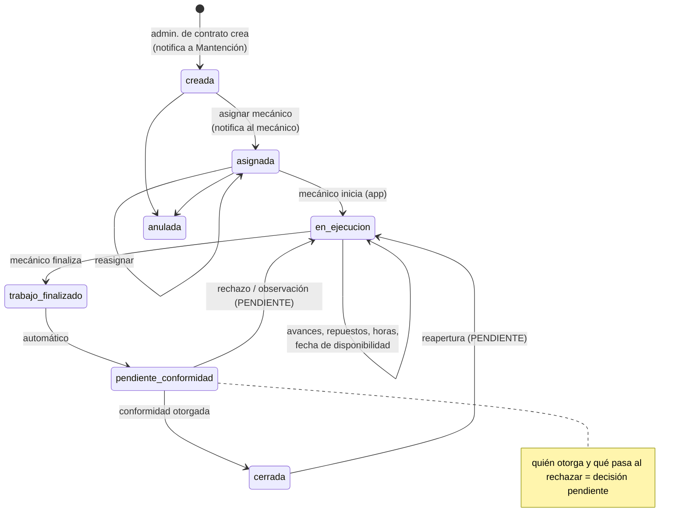

# Auditoría — Flujo de Órdenes de Trabajo (OT) de Mantención (2026-11-01)

Diagnóstico del flujo pedido: el administrador de contrato crea la OT → se notifica a Mantención
(Alexis) → se asigna al mecánico → ejecución → fecha de disponibilidad → fin de trabajos →
conformidad → cierre. Auditoría de solo lectura: no se modificó código. `main` en `3aa4573f7`.

## Cómo se verificó

| Fuente | Qué se hizo | Resultado |
|---|---|---|
| Código | Lectura de los dos módulos de mantención, RBAC, notificaciones, crons, pruebas y `PLAN-modulo-mantencion.md` | Base de los hallazgos |
| Suites existentes | `vitest` non-pglite: `maintenance-service`, `mantenciones-actions`, `app/(app)/mantenciones/actions`, `maintenance-validation`, `maintenance-reminders`, ruta cron de materialización | 6 archivos, **89/89** pasan |
| Suites PGlite | `maintenance-part-stock`, `inspection-maintenance-lifecycle-pglite`, `operational-control-maintenance-pglite` | 3 archivos, **11/11** pasan |
| Sondeo en `bodega_dev` | Script fuera del repo que llama a los servicios reales (`lib/services/maintenance.ts`) con sesiones armadas desde el RBAC de la base (`getUserRbacById`) | Escenarios S1–S12, abajo |
| Base `bodega_dev` | Permisos por rol (`role_permissions`) | `admin_contrato` sin ningún `mantenciones:*` ni `mant:*`; `mecanico` sólo con `mant:app:use` y `mant:records:view_own` |

**Datos de QA que quedaron en `bodega_dev`:** `OT-2026-0001` (completada) y `OT-2026-0002`
(en curso), ambas sobre KA-81 con la nota `QA_ auditoria flujo OT 2026-11-01`, más 9 filas de
`audit_log`.

**No verificado:**
- Producción: requiere autorización explícita. Quedan sin confirmar el interruptor del módulo `mantenciones`, los roles reales de Alexis y de los mecánicos, y si existen OT.
- Recorrido en navegador.
- Concurrencia en paralelo real: se simuló en secuencia con un estado leído antes.
- Falla de una notificación: el flujo no emite ninguna.

### Escenarios ejecutados (sondeo)

| # | Escenario | Resultado observado |
|---|---|---|
| S1 | El administrador de contrato crea una OT | Rechazado: «Sin permisos para registrar mantenciones» |
| S2 | El jefe de mantención crea una OT válida | `OT-2026-0001`, con `created_by` y `created_at` registrados |
| S3 | Se repite el mismo envío | Se crea una segunda OT, `OT-2026-0002` (sin idempotencia) |
| S4a | Responsables elegibles | 5 usuarios, **todos de rol global**; ningún mecánico |
| S4b | Asignar a un administrador de contrato | Rechazado: «El responsable no está activo o no puede gestionar mantenciones en esta faena» |
| S5 | Dos ediciones sobre el mismo estado leído | La segunda pisa a la primera en silencio: las notas de A se pierden y `version` llega a 3 |
| S9 | Transición con estado esperado obsoleto | Rechazada: «La mantención cambió en otra sesión» |
| S6 | Completar una OT programada sin iniciarla | Permitido; queda `startedAt: null` |
| S7 | Cancelar una OT completada | Permitido |
| S8 | Reabrir una OT cancelada | Permitido (pasa a `in_progress`) |
| S11 | Un usuario distinto del responsable inicia la OT | Permitido |
| S12 | Completar sin conformidad | Permitido; `completed` es el cierre |
| N | Notificaciones generadas por S2–S12 | **0** |
| A | Auditoría de S2–S12 | 9 filas (`create`, `update`, `status_change`, `cancel`) |

---

## A. Resumen ejecutivo

En el repositorio hay dos módulos de mantención y **ninguno implementa el flujo pedido**.

- **`mantenciones`** (antiguo, tablas `maintenance_*`) es una OT de taller con costos, que se
  maneja desde la web. Tiene estados, responsable, SLA, tareas, repuestos con descuento de
  stock, mano de obra, documentos y aprobación de costos. Sólo la usan roles de jefatura.
- **`mantencion`** (nuevo, tablas `mant_*`) es la app del mecánico que funciona sin señal.
  Registra preventivas y correctivas **ya ejecutadas y firmadas**. Ahí la «Orden de trabajo»
  es un texto libre de 60 caracteres que no se vincula con ninguna OT.

El flujo no funciona de extremo a extremo. El plan del módulo lo registra como «Etapa 3», aún
sin construir (`PLAN-modulo-mantencion.md:226`).

**Bloqueos para producción:**
- El administrador de contrato no puede crear OT.
- No hay notificación al crear ni al asignar.
- El mecánico no tiene acceso a las OT y no se le puede asignar una.
- No existe la fecha de disponibilidad.
- No existe la conformidad: «completada» ya es el cierre definitivo.

**Defectos confirmados en ejecución:**
- Una edición pisa otra en silencio.
- Un doble envío crea dos OT.
- Se puede completar sin haber iniciado y cancelar una OT ya completada.

## B. Matriz de cumplimiento funcional

| # | Funcionalidad | Estado | Evidencia | Qué falta | Prioridad |
|---|---|---|---|---|---|
| 1a | Interfaz para crear OT | IMPLEMENTADO | `/mantenciones`, `app/(app)/mantenciones/maintenance-form.tsx` | — | — |
| 1b | El administrador de contrato puede crear | NO IMPLEMENTADO | `modules/mantenciones/manifest.ts:34-46` no lo incluye; S1 | Permiso y rol | Alta |
| 1c | Identificador único, autor y fecha | IMPLEMENTADO | `nextCodeTx(…, "OT", …)` en `lib/services/maintenance.ts:512`; S2 | El detalle no muestra al autor | Baja |
| 1d | Vínculo con equipo, faena e historial | IMPLEMENTADO | FK compuesta vehículo+faena, `db/schema/maintenance.ts:121-125`; ficha `/flota/[id]` | — | — |
| 1e | Validaciones contra OT inválidas | PARCIALMENTE IMPLEMENTADO | Sólo exige vehículo, fecha y tipo (`lib/validation/maintenance.ts:123-149`) | Descripción del trabajo obligatoria; idempotencia (S3) | Media |
| 2a | Notificación automática al crear | NO IMPLEMENTADO | Ninguna llamada a notificaciones en `lib/services/maintenance.ts:500-581`; escenario N | Evento y destinatario | Alta |
| 2b | Registro, reintento y falla del aviso | NO IMPLEMENTADO | Sólo existe el cron de SLA; un correo fallido queda sólo en el log (`lib/services/notification-create.ts:193-195`) | Política de entrega | Media |
| 2c | Alexis identificado sin valores fijos | PENDIENTE DE DEFINICIÓN FUNCIONAL | Alexis sólo es un usuario sembrado con `jefe_mantencion` (`db/seed/nuevos-roles.ts:41`); el cron de SLA filtra por el nombre de rol | Destinatario por rol o por configuración | Media |
| 3a | Asignar responsable | IMPLEMENTADO CON ERRORES | Exige `mantenciones:edit` en la faena (`lib/services/maintenance.ts:448-454`); S4a | No se puede asignar a mecánicos | Alta |
| 3b | El mecánico consulta sus OT | NO IMPLEMENTADO | `mecanico` sin `mantenciones:view`; no hay filtro por responsable (`lib/services/maintenance.ts:47-54`) | Bandeja en la app | Alta |
| 3c | Aviso al mecánico de una OT nueva | NO IMPLEMENTADO | Sólo el recordatorio de SLA, y sólo si la OT tiene `slaDueAt` (`lib/services/maintenance-reminders.ts:26-27`) | Notificación de asignación | Alta |
| 3d | Aceptar, rechazar o reasignar, con trazas | PARCIALMENTE IMPLEMENTADO | Se reasigna editando y queda en `audit_log`; no hay aceptar ni rechazar | Decisión funcional | Baja |
| 3e | Cualquier mecánico en cualquier faena | IMPLEMENTADO CON ERRORES | Módulo antiguo: restringe por faena (`lib/services/maintenance.ts:450`, `:1539`; `maintenance-form.tsx:135-136`). Módulo nuevo: lo permite con aviso `out_of_worksite` (`lib/services/mantencion/records-create-validate.ts:55-62`) | Sin restricción en la OT nueva | Alta |
| 4a | Iniciar formalmente / estado «en curso» | PARCIALMENTE IMPLEMENTADO | `start` → `in_progress`, sólo para quien tiene `mantenciones:edit` | Que lo haga el mecánico | Alta |
| 4b | Trabajos, repuestos y horas asociados | PARCIALMENTE IMPLEMENTADO | Tareas, repuestos (egreso de stock) y mano de obra (`lib/services/maintenance.ts:1003-1219`); la correctiva de la app tiene trabajos, horas y repuestos sin vínculo a una OT | Unir ejecución y OT | Alta |
| 4c | Guardar avances sin finalizar | PARCIALMENTE IMPLEMENTADO | En la web, líneas de a una; en la app, borrador local y firma definitiva | Avance de una OT en la app | Media |
| 4d | Historial de modificaciones | IMPLEMENTADO CON ERRORES | `recordAudit` en cada escritura (A); la edición no controla versión (S5) | Concurrencia optimista | Media |
| 4e | Bloqueo de transiciones incorrectas | IMPLEMENTADO CON ERRORES | Rechaza el estado viejo (S9), pero permite `scheduled→completed` (S6) y `completed→cancelled` (S7) | Reglas de estados | Media |
| 5a | Campo «fecha de disponibilidad» | NO IMPLEMENTADO | No existe. Lo cercano: `sla_due_at` (compromiso), `downtime_ended_at` (fin real, al completar), `mant_workshop_updates.exit_date` («Ya salió», app) | Definir y crear el campo | Alta |
| 5b | Visible en seguimiento / ligado al equipo | NO IMPLEMENTADO | — | — | Alta |
| 5c | Quién puede modificarla | PENDIENTE DE DEFINICIÓN FUNCIONAL | — | — | Media |
| 6a | Acción de finalizar con usuario y fecha | PARCIALMENTE IMPLEMENTADO | `complete` fija `completedAt` y la auditoría guarda al usuario; no la ejecuta el mecánico | Que la ejecute el mecánico | Alta |
| 6b | Trabajo terminado distinto de OT cerrada | NO IMPLEMENTADO | Estados posibles: `scheduled`, `in_progress`, `completed`, `cancelled` (`db/schema/maintenance.ts:103-105`) | Estado intermedio | Alta |
| 6c | Datos exigidos antes de finalizar | PARCIALMENTE IMPLEMENTADO | Exige tareas cerradas, documentos según política y costos aprobados si se pidió (`lib/services/maintenance.ts:1549-1554`) | Definir lo mínimo | Media |
| 7a–7f | Conformidad (estado, actor, aprobar u observar, trazas) | NO IMPLEMENTADO | `decideMaintenanceCostApproval` aprueba **costos**, no trabajo (`lib/services/maintenance.ts:1221-1253`); la revisión de la app es de jefatura sobre registros firmados | Todo | Alta |
| 7g | Responsable y trato de rechazos | PENDIENTE DE DEFINICIÓN FUNCIONAL | El plan dice «conformidad del administrador de contrato» y deja abierto el rechazo | Confirmar | Alta |
| 8a | Cierre con fecha registrada | PARCIALMENTE IMPLEMENTADO | El cierre es `complete` (`completedAt`) | Separarlo de la finalización | Alta |
| 8b | Cierre condicionado a conformidad | NO IMPLEMENTADO | S12 | — | Alta |
| 8c | OT cerrada inmutable / reapertura controlada | IMPLEMENTADO CON ERRORES | Líneas bloqueadas, pero acepta documentos (`lib/services/maintenance.ts:1137-1167`); reabrir o cancelar sólo pide `edit` (S7, S8) | Rol y reglas de reapertura | Media |
| 8d | Actualiza estado del equipo e historial | IMPLEMENTADO | `setVehicleOperationalStatus` al iniciar y terminar (`lib/services/maintenance.ts:1574-1605`); avanza el plan preventivo; acredita la CAPA | — | — |

## C. Flujo actual

1. Crea la OT alguien con `mantenciones:create`: `administrador`, `jefa_chome` o `jefe_mantencion`. También nace de un hallazgo de inspección o de un plan preventivo, materializado a mano.
2. No se avisa a nadie.
3. Opcionalmente se asigna un responsable, que debe tener `mantenciones:edit` en la faena del equipo.
4. Cualquier usuario con `edit` la inicia, agrega líneas y la completa. Completar es cerrar.

Por separado, el mecánico registra correctivas firmadas en `/m/mantencion` y puede anotar un
número de OT como texto, sin vínculo con la OT.



**Interrupciones:**
- No hay aviso entre la creación y Mantención: el único aviso es el cron de SLA de las 06:00.
- El mecánico queda fuera del circuito de la OT.
- No hay fecha de disponibilidad.
- No hay conformidad.
- Los dos módulos no se conectan entre sí.

**Pasos manuales:**
- Materializar planes: `scripts/cron-runner.mjs` no incluye `maintenance-plan-materialization`.
- Las transiciones sólo se ofrecen en la fila de la lista (`app/(app)/mantenciones/maintenance-row-actions.tsx:98-107`), no en el detalle.

## D. Flujo objetivo (propuesta)



- **Requisitos confirmados en el pedido:**
  - El administrador de contrato crea la OT.
  - Se notifica a Mantención.
  - El mecánico la ejecuta.
  - Cualquier mecánico trabaja en cualquier faena.
  - La OT lleva fecha de disponibilidad.
  - Finalizar el trabajo no es lo mismo que la conformidad.
  - La conformidad va antes del cierre.
- **Decisiones pendientes:** sección G.
- **Recomendaciones técnicas:**
  - Construir la OT en el módulo nuevo, donde la ubica el plan y donde ya están los mecánicos y su app.
  - Reutilizar del antiguo el patrón de transiciones con estado esperado, la auditoría y `setVehicleOperationalStatus`.
  - Avisar con `notifyAfterCommit` / `createNotifications` y `dedupeKey`.
  - Que la correctiva firmada referencie la OT por su `id`, no por texto.

## E. Hallazgos técnicos

**1. High: el administrador de contrato no puede crear OT**
- **Dónde:** `modules/mantenciones/manifest.ts:34-46` (`defaultGrants` sin `admin_contrato`).
- **Evidencia:** S1 y los permisos en la base.
- **Impacto:** la etapa 1 no puede iniciarse por el actor definido.
- **Corrección:** un permiso de creación de OT acotado a sus faenas.

**2. High: el mecánico no puede recibir ni ejecutar una OT**
- **Dónde:** `lib/services/maintenance.ts:448-454` y `:463-489`.
  ```ts
  const eligible = await getUserIdsWithPermissionForWorksite("mantenciones:edit", worksiteId)
  if (!eligible.includes(assignedToUserId)) throw new Error("El responsable no está activo o no puede gestionar…")
  ```
- **Evidencia:** S4a: 5 elegibles, todos globales. `mecanico` no tiene `mantenciones:view`.
- **Impacto:** las etapas 3, 4 y 6 no las realiza el mecánico.
- **Corrección:** asignación y bandeja de OT en el módulo nuevo (`mant:app:use`).

**3. High: no se notifica al crear ni al asignar**
- **Dónde:** `lib/services/maintenance.ts:500-581`, sin ninguna llamada a notificaciones.
- **Evidencia:** escenario N (0 notificaciones). El único aviso es `lib/services/maintenance-reminders.ts`: por SLA, a las 06:00 y sólo si `slaDueAt` no es nulo.
- **Corrección:** `notifyAfterCommit` en la creación y en la asignación, con `dedupeKey`.

**4. High: no hay conformidad; «completada» es el cierre**
- **Dónde:** `db/schema/maintenance.ts:103-105` y `lib/services/maintenance.ts:1487-1494`.
- **Evidencia:** S12.
- **Impacto:** no se distingue «trabajo terminado» de «OT conforme y cerrada».
- **Corrección:** estados nuevos más una acción de conformidad con actor, fecha y motivo.

**5. Medium: transiciones permisivas**
- **Dónde:** `lib/services/maintenance.ts:1489-1493`, con un único permiso (`:1511`).
  ```ts
  complete: { from: ["scheduled", "in_progress"], to: "completed" },
  cancel: { from: ["scheduled", "in_progress", "completed"], to: "cancelled" },
  ```
- **Evidencia:** S6, S7 y S8.
- **Impacto:** OT cerradas sin ejecución registrada, y cierres revertidos sin separación de funciones.

**6. Medium: una edición pisa otra en silencio**
- **Dónde:** `lib/services/maintenance.ts:583-691` incrementa `version` sin compararla; `app/(app)/mantenciones/actions.ts:75-96` no envía la versión esperada.
- **Evidencia:** S5.
- **Corrección:** `expectedVersion` y `UPDATE … WHERE version = ?`, como `saveMaintenancePlan` (`:869-876`).

**7. Medium: la creación no es idempotente**
- **Dónde:** `lib/services/maintenance.ts:564-581`. La OT sólo es única por hallazgo o por plan+fecha (`db/schema/maintenance.ts:134-137`).
- **Evidencia:** S3.
- **Corrección:** una clave de idempotencia del cliente, como `mant_records.id`.

**8. Medium: cualquiera con `edit` opera OT asignadas a otro**
- **Dónde:** `lib/services/maintenance.ts:1511`, sin comprobar el responsable.
- **Evidencia:** S11.
- **Corrección:** definir qué acciones son exclusivas del responsable.

**9. Medium (PLAUSIBLE, deducido del código, no ejecutado): los planes por lectura duplican OT cada día**
- **Dónde:** `lib/services/maintenance.ts:943-966` y `:980-1001`.
- **Mecanismo:** con `nextDueDate` nulo, `maintenanceDate = today`. `alreadyMaterialized` sólo mira esa fecha y el índice único es (plan, fecha), así que mientras la OT siga abierta cada día nace otra.
- **Corrección:** comprobar si el plan tiene alguna OT abierta.

**10. Medium: restricción por faena en el módulo antiguo**
- **Dónde:** `lib/services/maintenance.ts:450` y `:1539`; `app/(app)/mantenciones/maintenance-form.tsx:135-136`.
- **Impacto:** contradice la regla de que cualquier mecánico trabaje en cualquier faena. Hoy no se manifiesta porque todos los elegibles son globales, pero bloqueará en cuanto se habiliten mecánicos.

**11. Low: el cron de materialización no está programado**
- **Dónde:** `app/api/cron/maintenance-plan-materialization/route.ts` existe, pero no está en `scripts/cron-runner.mjs` ni en `docker-compose.yml`, donde sólo figura `maintenance-reminders` (línea 389).

**12. Low: se adjuntan documentos a una OT cerrada**
- **Dónde:** `lib/services/maintenance.ts:1137-1167` no comprueba el estado. La UI lo oculta, pero la server action lo acepta.

**13. Low: las tareas no se pueden cancelar**
- **Dónde:** `lib/services/maintenance.ts:1017-1030` sólo alterna entre `completed` y `pending`, pero el cierre pide «Completa o cancela todas las tareas» (`:1552`).

**14. Low: limitaciones del aviso de SLA**
- **Dónde:** `lib/services/maintenance-reminders.ts:38` filtra por el nombre de rol `jefe_mantencion`.
- **Impacto:** no hay aviso si la OT no tiene SLA, y un correo fallido sólo queda en el log, sin reintento.

**15. Low: la creación sin permiso de costos guarda ceros**
- **Dónde:** `lib/services/maintenance.ts:566-568`. Es el criterio que MNT-003 eliminó para las líneas.

**16. Low (UI): el detalle no muestra autor ni acciones de estado**
- **Dónde:** `app/(app)/mantenciones/[id]/maintenance-order-workbench.tsx:26-47`.

**17. Informational: dos sistemas de mantención en paralelo**
- El `work_order` de la app es texto libre (`lib/mantencion/contracts.ts:125`, `db/schema/mantencion-records.ts:137`).
- Apagar el módulo antiguo es la decisión abierta P5 (`PLAN-modulo-mantencion.md:196`).

## F. Brechas de implementación

| Brecha | Reutilizable | Por modificar | Nuevo | Dependencias | Complejidad |
|---|---|---|---|---|---|
| Modelo y máquina de estados de OT | Patrón `TRANSITION_RULES` + estado esperado, `recordAudit`, `nextCodeTx` | `modules/mantencion-equipos/manifest.ts`, `lib/auth/system-rbac.ts` | Tablas de OT y transiciones (migración generada), servicio | Decisión sobre el módulo antiguo | Alta |
| Creación por el administrador de contrato | `fuel_vehicles`, `worksite_users`, `PageHeader`, `Dialog`, `Field` | Manifest (permiso), navegación | Pantalla web de OT y acción con idempotencia | RBAC (`sync-rbac`) | Media |
| Notificación a Mantención y al mecánico | `createNotifications`, `notifyAfterCommit`, `dedupeKey`, `notification-targeting` | — | Tipos y textos | Destinatario (G2) | Baja |
| Asignación sin restricción de faena | `findAppUsers`, aviso `out_of_worksite` | — | Asignar y reasignar | Quién asigna (G3) | Media |
| Bandeja y ejecución en la app | Cola sin señal, credencial de dispositivo, catálogo con ETag, correctiva | `lib/mantencion/contracts.ts`, `catalog.ts`, la correctiva | Sincronización de OT (iniciar, avanzar, finalizar) | Conflictos entre dispositivo y servidor | Alta |
| Fecha de disponibilidad | `mant_workshop_updates` como referencia | Detalle, panel, ficha del equipo | Campo con historial | Significado (G6) | Media |
| Conformidad y cierre | Patrón de `mant_record_observations` | — | Aprobar u observar, estado y vista para quien la otorga | Actor y rechazos (G4, G5) | Media |
| Estado operacional del equipo | `setVehicleOperationalStatus` | — | Enganche a la OT nueva | Flota, Control operacional | Baja |
| Arreglos del módulo antiguo (si sigue en uso) | — | Hallazgos 5–7, 9 y 11–13 | — | Decisión P5 | Baja–Media |

## G. Decisiones funcionales pendientes

1. **¿En qué módulo vive la OT y qué pasa con `mantenciones`?** El plan (29-10-2026) dice «flujo nuevo en este módulo», es decir, el nuevo. ¿Se apaga el antiguo (P5) o convive? ¿Qué pasa con los costos y la aprobación de costos?
2. **Responsabilidad de Alexis.** El plan registra «se notifica a Alexis → Alexis asigna al mecánico», pero el pedido de esta auditoría lo trata como no definido, así que hay que confirmar cuál vale. ¿Se notifica al rol `jefe_mantencion` o a una persona configurada? ¿Hay suplente?
3. **Asignación de mecánicos.** ¿La hace jefatura o el mecánico toma la OT? ¿Una OT tiene uno o varios mecánicos? ¿Puede rechazarla?
4. **Responsable de la conformidad.** El plan dice el administrador de contrato. ¿Se confirma? ¿Debe ser el mismo que creó la OT?
5. **OT rechazada en la conformidad.** ¿Vuelve a ejecución? ¿Exige motivo? ¿Se notifica? ¿Hay un límite de ciclos? El plan lo deja abierto.
6. **Fecha de disponibilidad.** ¿Es estimada, real o ambas? ¿Quién la fija y quién la cambia? ¿Cambia el estado operacional del equipo? El plan lo deja abierto.
7. **Cierre y reapertura.** ¿El cierre es automático al dar la conformidad? ¿Quién reabre y con qué motivo? ¿Se puede anular una OT cerrada?
8. **Datos mínimos.** ¿Qué se exige al crear (descripción de la falla, prioridad) y qué al finalizar (lecturas, horas, fotos, fecha de disponibilidad)?

## H. Plan de implementación recomendado

**Fase 0. Decisiones G1–G8, escritas en el §12 del plan.** Sin esto no se implementan las fases 1, 3, 4 y 5.

**Fase 1. Modelo y estados.**
- Contenido: migración generada; servicio de transiciones con control de versión y estado esperado, idempotencia y auditoría; RBAC con paridad entre manifest, navegación y `sync-rbac`.
- Aceptación: no hay transición fuera de la máquina de estados, el estado viejo se rechaza y el doble envío produce una sola OT.
- Pruebas: matriz de transiciones y permisos en PGlite; carrera de dos actualizaciones.

**Fase 2. Creación y notificación.**
- Contenido: pantalla web para `admin_contrato` acotada a sus faenas; aviso a Mantención después del commit.
- Aceptación: crea en su faena y no en otra; llega exactamente una notificación, y ninguna si la transacción falla.
- Pruebas: PGlite y una E2E del alta.

**Fase 3. Asignación y bandeja del mecánico.**
- Aceptación: un mecánico de la faena A recibe y ve una OT de la faena B; la reasignación queda trazada.
- Pruebas: sincronización en PGlite y `e2e/mantencion-4-permisos.spec.ts`.

**Fase 4. Ejecución, avances, fecha de disponibilidad y finalización desde la app.**
- Aceptación: funciona sin señal con reintentos idempotentes; finalizar no cierra la OT; la fecha de disponibilidad queda con historial.
- Pruebas: cola con `fake-indexeddb`, sincronización HTTP en PGlite y E2E sin señal.

**Fase 5. Conformidad y cierre.**
- Aceptación: no se cierra sin conformidad; queda registrado quién la otorgó y cuándo; el rechazo sigue la regla decidida.
- Pruebas: PGlite y E2E del flujo completo, de la creación al cierre.

**Fase 6. Integración.**
- Contenido: estado operacional del equipo, hoja de vida, panel, exportación a Excel; si el antiguo sigue vivo, los hallazgos 5–7, 9 y 11–13.
- Aceptación: recorrido asistido en navegador con su reporte en `qa/reports/`.

## I. Evaluación final

**Metodología:** 25 subrequisitos (las filas de B), con pesos que suman 100 y favorecen los
puntos de control propios del pedido (notificación, asignación, conformidad). Cada uno vale 1 si
está implementado, 0,5 si es parcial o tiene errores, y 0 si no existe.

| Etapa | Peso | Puntaje |
|---|---|---|
| 1 Creación | 15 | 9,5 |
| 2 Notificación | 10 | 0 |
| 3 Asignación | 15 | 3 |
| 4 Ejecución | 15 | 13 |
| 5 Fecha de disponibilidad | 10 | 0 |
| 6 Finalización | 10 | 5,5 |
| 7 Conformidad | 15 | 0 |
| 8 Cierre | 10 | 6 |
| **Total** | **100** | **37** |

- **Cumplimiento funcional: 37 %** si se cuenta la capacidad que existe en el sistema, aunque la use un actor distinto del pedido. **22 %** si las etapas 4 y 6 se exigen al mecánico (4a, 4b, 4c y 6a valen 0).
- **Cobertura de pruebas:**
  - 12 de las 25 filas tienen alguna prueba unitaria o de PGlite (1a, 1d, 3a, 4a, 4b, 4d, 4e, 6a, 6c, 8a, 8c, 8d). Todas cubren comportamiento ya existente; la de 3a prueba la restricción por faena que el pedido contradice.
  - Ningún requisito nuevo tiene prueba.
  - E2E del flujo: ninguna. `e2e/mantenciones.spec.ts` sólo comprueba que la página carga.
- **Preparación para producción del flujo pedido:** no apto.
- **Principales bloqueos:** decisiones G1, G2, G4, G5 y G6; administrador de contrato sin permiso; mecánico fuera del circuito; ausencia de notificación, fecha de disponibilidad y conformidad.
- **Para considerar el flujo operativo:** fases 0 a 5 completas, con PGlite y la E2E de creación a cierre en verde; la fase 6 si el módulo antiguo sigue en uso.
